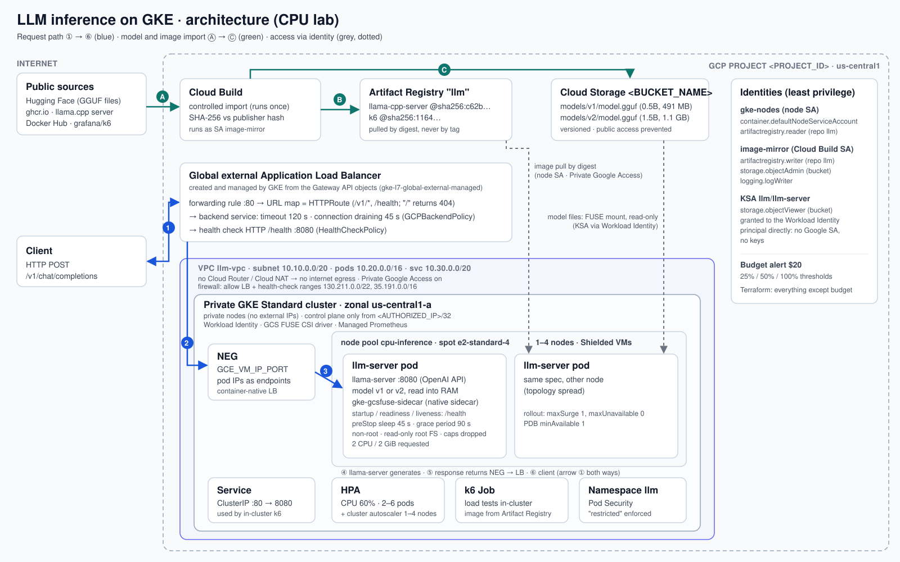

# LLM inference on GKE

A personal lab: an open-weights LLM served by **llama.cpp** on a **private GKE
cluster**, built with **Terraform**, with model versions swapped under load and every
result measured. Built and tested on 2026-11-18.

> **Scope.** CPU inference with small 4-bit models (Qwen2.5 0.5B and 1.5B) on spot
> `e2-standard-4` nodes. **No GPUs**: GPU quota wasn't available on the day. This is a
> lab, not a production system. Every number below comes from the runs in `results/`.

## Contents

- [Overview](#overview)
- [Architecture](#architecture)
- [How it works](#how-it-works)
- [Security design](#security-design)
- [The rollout finding](#the-rollout-finding)
- [Scaling results](#scaling-results)
- [Lessons learned](#lessons-learned)
- [Deploy it](#deploy-it)
- [Repository layout](#repository-layout)

## Overview

| | |
|---|---|
| **Serving** | llama.cpp server (OpenAI-compatible `/v1/chat/completions`) in 2 pods, behind the GKE Gateway API |
| **Models** | v1: Qwen2.5-0.5B-Instruct Q4_K_M · v2: Qwen2.5-1.5B-Instruct Q4_K_M (GGUF, from Hugging Face) |
| **Platform** | GKE Standard, zonal, private nodes, spot node pool autoscaling 1–4 |
| **Network** | Custom VPC, **no Cloud NAT**, so nodes have no internet egress; Private Google Access only |
| **Supply chain** | Cloud Build imports images and models once; SHA-256 checked against the publisher; images pinned by digest |
| **Identity** | Workload Identity: the model server reads the bucket without any key or Google service account |
| **Tests** | k6 load tests (8 rollout runs, 1 scaling run), 2 targeted SIGTERM experiments |

Measured serving speed, one request through the public Gateway (60 tokens):

| Model | Generation speed | Answer to "what is a readiness probe?" |
|---|---|---|
| v1 (0.5B) | ~43 tokens/s | wrong |
| v2 (1.5B) | ~20 tokens/s | correct |

## Architecture



Every resource in the project, with how each was created, is listed in
[`docs/inventory.md`](docs/inventory.md).

## How it works

### A request, end to end

1. **Client → load balancer.** The client POSTs to `http://<GATEWAY_IP>/v1/chat/completions`.
   The IP belongs to a **global external Application Load Balancer** that GKE builds
   from the `Gateway` object (`gke-l7-global-external-managed`).
2. **Routing.** The `HTTPRoute` becomes the URL map: only `/v1/*` and `/health` are
   routed (`/` returns 404). The backend service has a **120s timeout** (generation is
   slower than the 30s default) and **45s connection draining** (`GCPBackendPolicy`).
3. **Load balancer → pod.** The backend is a **container-native NEG**
   (`GCE_VM_IP_PORT`): the LB sends traffic straight to **pod IPs**, skipping node
   ports and kube-proxy. It only sends to pods that pass the LB health check on
   `/health:8080` (`HealthCheckPolicy`), and the pod's readiness gate waits for that check.
4. **Generation.** `llama-server` answers from the model already loaded in RAM. The
   firewall rule GKE created allows only Google's LB and health-check ranges
   (`130.211.0.0/22`, `35.191.0.0/16`) to reach the pods.
5. **Response** returns the same way, NEG → load balancer → client.

### Model and image import

The nodes **can't reach the internet**, so nothing is pulled at runtime:

- **A.** Cloud Build (running as its own service account, `image-mirror`) downloads the
  llama.cpp server image, the k6 image, and both GGUF files.
- **B.** The images are pushed to **Artifact Registry**, and their digests are recorded.
  The Deployment references the image **by digest** (`@sha256:c62b…`), never by tag.
- **C.** Each model file is checked against the **publisher's SHA-256** (from the
  Hugging Face API) and the build fails on a mismatch. Files are stored under
  `models/v1/` and `models/v2/` in a **versioned** bucket.

At pod start, the **GCS FUSE CSI driver** adds a sidecar that mounts the bucket
read-only, authenticated as the pod's Kubernetes ServiceAccount through Workload
Identity. `llama-server` reads the weights into RAM (`--load-mode none`).

### Model version swap

`scripts/deploy.sh v2` changes the model path and the `model-version` label, which
starts a rolling update: `maxSurge: 1`, `maxUnavailable: 0`, `minReadySeconds: 10`,
startup / readiness probes on `/health`, a 45s `preStop`, and a 90s grace period.

## Security design

| Control | How |
|---|---|
| No internet egress from nodes | No Cloud Router / Cloud NAT; nodes have no external IPs (`gcloud compute routers list` returns 0) |
| Control plane exposure | Public endpoint, but **master authorized networks** allow one `/32` only |
| Node identity | Dedicated SA with `roles/container.defaultNodeServiceAccount` + `artifactregistry.reader` on one repository, not the default Compute SA |
| Workload identity | KSA `llm/llm-server` gets `storage.objectViewer` on **one bucket**, granted to the Workload Identity principal directly. No keys, no Google SA, and `automountServiceAccountToken: false` |
| Build identity | `image-mirror` SA: write access to one repository and one bucket, plus logs |
| Supply chain | Publisher SHA-256 verification; images pinned by digest; bucket versioning; public access prevention; uniform bucket-level access |
| Pod hardening | Namespace enforces Pod Security **restricted**; non-root, read-only root filesystem, all capabilities dropped, `RuntimeDefault` seccomp |
| Nodes | Shielded VMs (secure boot, integrity monitoring), `GKE_METADATA` server |
| Edge | Only `/v1/*` and `/health` routed; LB health checks from Google ranges only |
| Cost guardrail | $20 budget alert (25 / 50 / 100%) |

**Gaps, stated honestly**

- The Gateway serves **plain HTTP**: no TLS certificate and no Cloud Armor in this lab.
- There's **no authentication** on the API.
- The project still has the auto-created **`default` VPC**, whose firewall rules allow
  SSH and RDP from `0.0.0.0/0`, and the **default Compute Engine SA holds
  `roles/editor`**. The lab uses neither, and Terraform didn't create them. Both
  should be removed, or prevented with the org policies
  `compute.skipDefaultNetworkCreation` and
  `iam.automaticIamGrantsForDefaultServiceAccounts`.

## The rollout finding

8 runs swapping v1 → v2 under load (k6, 4 concurrent users, inside the cluster against
the Service, swap starting 60s into a 4-minute run):

| # | Request size | HPA | preStop | k6 keep-alive | Requests | Failed |
|---|---|---|---|---|---|---|
| 1 | 48 tokens | **not pinned** (test bug) | 0s | on | 389 | 2 |
| 2 | 48 tokens | not pinned | 20s | on | 465 | 0 |
| 3 | 48 tokens | pinned at 2 | 0s | on | 385 | 0 |
| 4 | 48 tokens | pinned at 2 | 20s | on | 334 | 0 |
| 5 | 256 tokens | pinned at 2 | 0s | on | 112 | 0 |
| 6 | 256 tokens | pinned at 2 | 20s | on | 119 | 1 |
| 7 | 256 tokens | pinned at 2 | 45s | on | 132 | 2 |
| 8 | 256 tokens | pinned at 2 | 45s | **off** | 95 | **0** |

**5 failures out of 2,031 requests**, all `EOF`, and they didn't follow the obvious
pattern (a 45s preStop still failed). Two targeted experiments found the causes.

**1. What llama-server does on SIGTERM** (`scripts/sigterm-test.sh`). Send a
400-token generation (~20s) to a pod, delete that pod a few seconds in:

| preStop | Result |
|---|---|
| 0s | no response: the request **hung 85s** (90s grace period − 4s) until SIGKILL |
| 45s | **HTTP 200, all 400 tokens**, 21.9s, even though the pod was deleted at +6s |

llama-server stops generating on SIGTERM but leaves the connection open until SIGKILL.
So preStop has to outlast **endpoint removal plus the longest generation**.

**2. Keep-alive connections** (run 7). The 2 failures came at the exact **SIGKILL**
second, 90s after the pod's deletion, which means it was still receiving new requests
45s after leaving the Service. **Removing an endpoint only affects new
connections**: k6 reused keep-alive connections, and connection tracking kept
sending them to the terminating pod. Run 8, with connection reuse off: **0 failures**.

That's one run of 95 requests, so it **supports** the explanation but doesn't prove it.
A real fix needs something that drains existing connections: a proxy in front of
llama-server, the L7 load balancer path (it holds client connections and drains
backends), or bounded client keep-alive.

**What I can't claim:** that the platform achieves zero-downtime swaps. It doesn't
yet, through the in-cluster Service path.

## Scaling results

12 concurrent users for 6 minutes on model v2, HPA 2–6 pods at 60% CPU
(`results/scaling.csv`):

| Time | CPU (of request) | Desired pods | Ready pods |
|---|---|---|---|
| 0s | 0% | 2 | 2 |
| 22s | **87%** | **3** | 2 |
| 118s | 95% | 3 | **3** |
| 142s → end | 63–64% | 3 | 3 |

- The HPA asked for a 3rd pod **within 22s**, and it was **Ready about 96s later**
  (scheduling + loading 1.1 GB from GCS).
- **486 requests, 0 failed**, p95 **11.9s**. The 4-user rollout runs had p95 between
  2.65s and 4.77s (mixed v1/v2 traffic, so not a clean baseline): roughly **2.5–4.5×
  worse** (11.9 / 4.77 to 11.9 / 2.65).
- At 63% CPU the HPA stopped (inside its 10% tolerance) while latency was that much
  worse. CPU is a poor signal for LLM serving.
- Earlier in the day the **cluster autoscaler** scaled spot nodes **1 → 2 → 3 → 4**
  for Pending pods, then logged `max node group size reached`.

## Lessons learned

1. **Graceful shutdown is the server's job, not just Kubernetes'.** preStop buys time,
   but a server that doesn't close keep-alive connections keeps getting requests
   after it leaves the Service.
2. **Size preStop to the workload.** For LLMs that means the longest generation:
   cap `max_tokens` so it's known.
3. **When load tests don't add up, run a targeted experiment.** Five scattered EOFs in
   2,031 requests were explained by two small deterministic tests.
4. **Check the test's own conditions.** My first runs claimed a fixed 2 replicas
   while the HPA scaled to 4: `deploy.sh` re-applied it. HPA events showed this.
5. **Scale LLM serving on queue depth, not CPU.**
6. **Pin images by digest.** llama.cpp renamed `--no-mmap` between builds.
7. **Read every Terraform plan.** An `-auto-approve` re-apply replaced the whole cluster.

The full record, including my mistakes, is in
[`docs/troubleshooting-log.md`](docs/troubleshooting-log.md).

## Deploy it

**Requirements:** Linux or WSL with `gcloud`, `terraform` ≥ 1.6, `kubectl`, `envsubst`;
a GCP project with billing; Owner (or equivalent) on it. Cost for the day this was
built is estimated at **under $1** (spot nodes, LB, disks); the zonal cluster fee is
covered by GKE's free tier.

```bash
# 0. a gcloud configuration pinned to your account + project
gcloud config configurations create llm-lab
gcloud config set account <ACCOUNT_EMAIL>
gcloud config set project <PROJECT_ID>
gcloud services enable container.googleapis.com compute.googleapis.com \
  artifactregistry.googleapis.com cloudbuild.googleapis.com iam.googleapis.com
export PROJECT_ID=<PROJECT_ID>
source scripts/env.sh

# 1. infrastructure (read the plan before applying)
echo 'authorized_cidr = "<AUTHORIZED_IP>/32"' > terraform/terraform.tfvars
terraform -chdir=terraform init
terraform -chdir=terraform plan -out=tfplan
terraform -chdir=terraform apply tfplan

# 2. controlled import: images + checksum-verified models
bash scripts/import.sh

# 3. cluster access + serving
bash scripts/kubeconfig.sh
bash scripts/deploy.sh v1                     # model v1, preStop 45s
kubectl -n llm get gateway llm-gateway        # wait for ADDRESS, then:
curl http://<GATEWAY_IP>/v1/chat/completions -H 'Content-Type: application/json' \
  -d '{"messages":[{"role":"user","content":"Hello"}],"max_tokens":40}'

# 4. tests
bash scripts/rollout-test.sh                  # env: MAX_TOKENS, NO_REUSE, ONLY_SAFE, SAFE_PRESTOP
bash scripts/scale-test.sh
bash scripts/sigterm-test.sh 0                # then 45

# 5. teardown: LB/NEGs first, then terraform destroy
bash scripts/teardown.sh
```

## Repository layout

```
terraform/     VPC, private GKE + node pool, Artifact Registry, GCS, IAM, Workload Identity
import/        Cloud Build config: image mirroring + SHA-256-checked model import
k8s/           namespace, Deployment, Service, HPA, PDB, Gateway, HTTPRoute, LB policies, k6 Job
loadtest/      k6 script
scripts/       env, kubeconfig, deploy, rollout / scale / SIGTERM tests, teardown
results/       scaling.csv, raw k6 and experiment logs
docs/          architecture diagram, resource inventory, troubleshooting log
```

**Not covered yet:** GPU serving (vLLM, quantization against VRAM limits),
queue-depth autoscaling, blue-green via HTTPRoute weights, CI/CD (GitHub Actions →
Workload Identity Federation → Argo CD), TLS / Cloud Armor, and a draining proxy.
